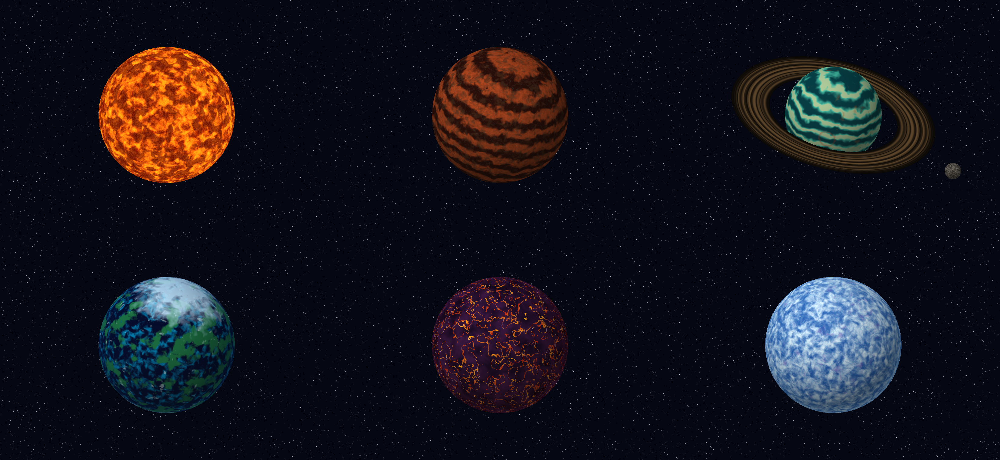
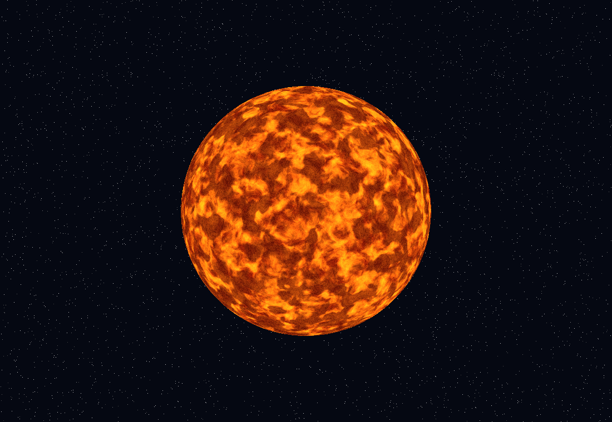
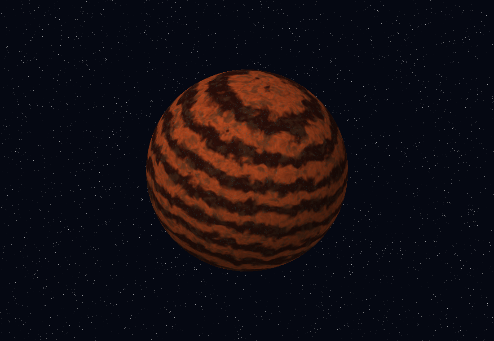
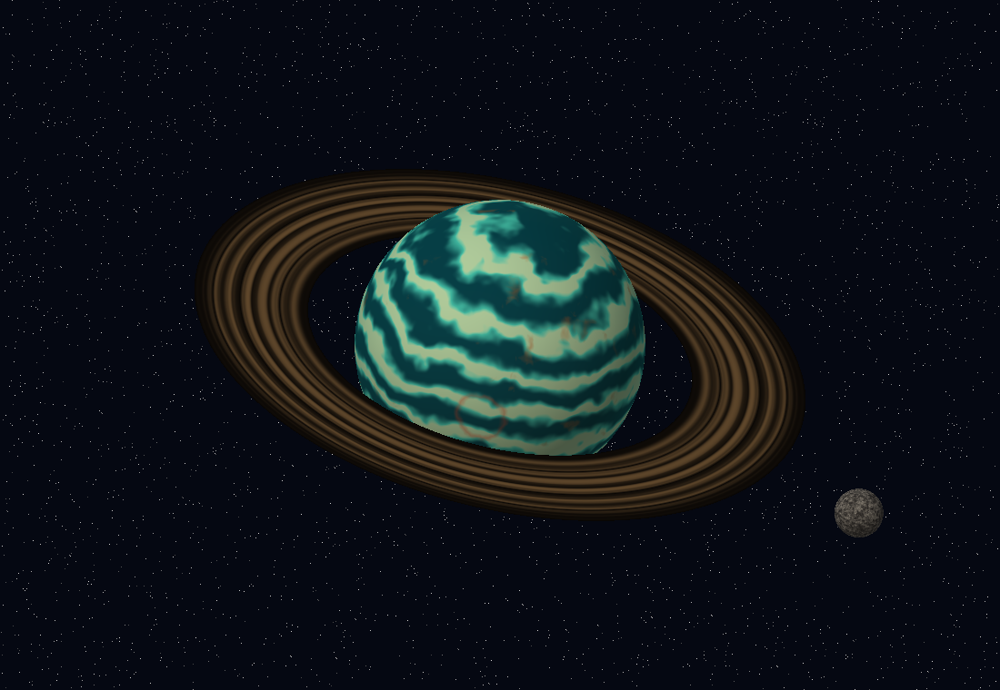
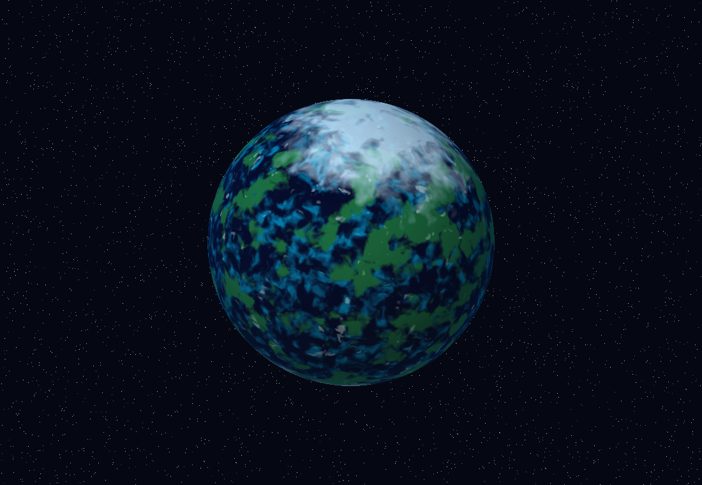
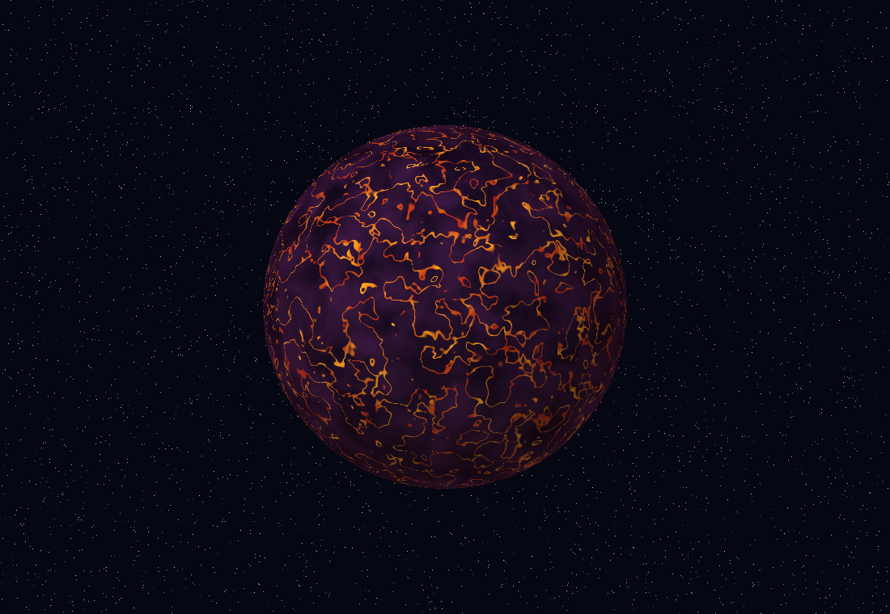
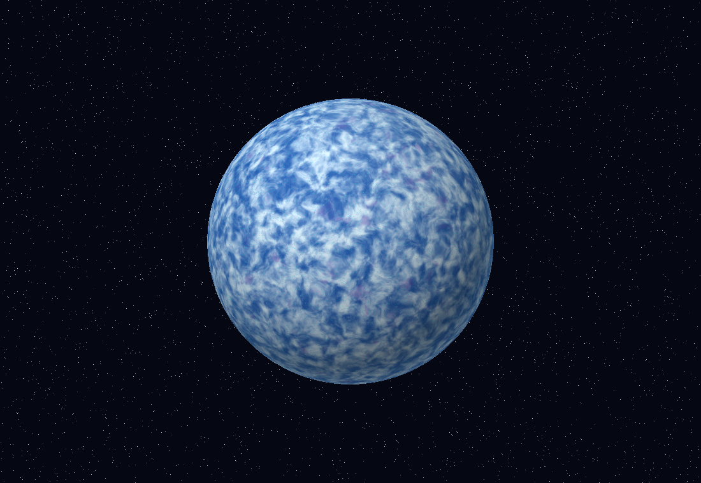

# Laboratorio 5 — Atlas de mundos procedurales

Software renderer escrito en Rust: seis cuerpos celestes, anillos y una luna. El color de cada fragmento se calcula en CPU con funciones matemáticas, ruido 3D y parámetros de posición, normal y tiempo. No se cargan texturas, mapas de imagen, archivos MTL ni materiales externos.

## Galería

Capturas generadas con `--render-all --time 0`: la galería reúne seis paneles completos de 1100 × 760 píxeles en una cuadrícula de 3 × 2.



### 1. Sol — Granulación y fuego



Fotosfera cobriza y dorada, con cuatro capas de color: granulación, plasma convectivo, manchas solares oscuras y filamentos calientes. Es emisivo: su color no depende de la iluminación difusa de los planetas. El tiempo perturba el ruido del plasma.

### 2. Rocoso — Estratos minerales



Estratos terracota, cuencas de regolito, inclusiones minerales y vetas cian. Las cuatro capas se combinan antes de aplicar iluminación y un borde atmosférico tenue.

### 3. Gigante gaseoso — Tormentas de jade



Bandas turquesa, nubes crema, turbulencia ocre y una región de tormenta rojiza. Los anillos son una malla anular independiente con bandas radiales y divisiones oscuras procedurales. La luna se dibuja como una esfera independiente; no forma parte de la malla del planeta. El z-buffer resuelve qué superficies quedan delante y detrás.

### 4. Oceánico — Mares de zafiro (extra)



Océanos azul profundo, plataformas turquesa, continentes verdes, nubes y casquetes de hielo: cinco contribuciones de color.

### 5. Volcánico — Ríos de magma (extra)



Basalto violeta, fisuras de magma, núcleos incandescentes y ceniza. La superficie oscura contrasta con la red naranja de las grietas.

### 6. Helado — Fracturas de cristal (extra)



Crestas de hielo azul y blanco, fracturas cian, depósitos violetas y escarcha polar. La distribución se evalúa en 3D para evitar costuras de una textura equirectangular.

## Ejecutar

Requisitos: Rust y Cargo, con un linker nativo disponible. Python 3 solo es necesario para las pruebas de integración. `minifb` presenta el framebuffer en una ventana; no ejecuta shaders de GPU.

Desde la raíz del repositorio:

```sh
cargo run --release
```

Para reproducir todas las capturas sin abrir una ventana:

```sh
cargo run --release -- --render-all --time 0
```

Para exportar un cuerpo individual:

```sh
cargo run --release -- --headless --body gaseoso --time 0 --output screenshots/gaseoso.png
```

Los nombres de CLI son `sol`, `rocoso`, `gaseoso`, `oceanico`, `volcanico` y `helado`. Con el mismo tiempo y los mismos argumentos se obtiene la misma imagen dentro de la misma compilación/plataforma.

## Controles

| Tecla | Acción |
| --- | --- |
| 1–6 | Elegir cuerpo |
| Tab | Siguiente cuerpo |
| Espacio | Pausar o reanudar animación |
| Flechas | Rotar el cuerpo y su escena |
| O | Activar o desactivar traslación oscilante |
| S | Guardar `screenshots/capture.png` |
| Esc | Salir |

## Pipeline y complejidad

1. Generación matemática de una esfera UV y de un anillo independiente.
2. Rotación, escala y traslación de cada objeto; proyección ortográfica.
3. Rasterización de triángulos con coordenadas baricéntricas.
4. Interpolación de posición local y normales por fragmento.
5. Evaluación del shader elegido y comparación de profundidad en el z-buffer.
6. Presentación en ventana o escritura de PNG.

El ruido de valor usa interpolación suave en una rejilla 3D. fBm superpone octavas con distintas frecuencias; el domain warping deforma las coordenadas para romper patrones regulares. Las capas afectan el color, no desplazan la geometría. La iluminación no se cuenta como una de las cuatro capas de diseño.

## Correspondencia con la rúbrica

| Requisito | Implementación |
| --- | --- |
| Estrella, rocoso y gaseoso | Tres shaders distintos seleccionables |
| Complejidad de color | Al menos cuatro contribuciones por cuerpo, documentadas en `src/shaders.rs` |
| Planetas adicionales | Oceánico, volcánico y helado |
| Anillos | Geometría separada y shader radial, sin texturas |
| Luna | Esfera separada y shader de superficie propio |
| Capturas en README | Seis imágenes y galería generadas |
| Animación | Parámetro temporal; controles interactivos no probados manualmente |

La creatividad y la puntuación final dependen de la evaluación del docente; esta tabla no garantiza una nota. Candidato sugerido para el concurso: el gigante gaseoso con sus anillos y luna, `screenshots/gaseoso.png`.

## Pruebas

```sh
cargo test
cargo clippy -- -D warnings
cargo build
python tests/verify_render.py --self-test
python tests/verify_render.py
```

El verificador ejecuta el binario real en modo headless y comprueba las seis salidas PNG, CRC, descompresión, dimensiones, diversidad, igualdad de cada panel completo con su imagen, determinismo, animación y rechazo de argumentos inválidos. Los resultados efectivos y pendientes se registran en `docs/VERIFICATION.md`. El ejecutable puede pasarse como argumento para usar otro perfil o plataforma:

```sh
python tests/verify_render.py target/release/lab5-graficas.exe
# Linux/macOS:
python3 tests/verify_render.py target/release/lab5-graficas
```

## Base y estructura

Se reutilizaron `color.rs`, `framebuffer.rs` y `png.rs` del laboratorio anterior, con pruebas de regresión agregadas al framebuffer. El rasterizador se adapta para evaluar color por fragmento en vez de usar materiales de caras. Las esferas y anillos se generan por código, por lo que no se necesita descargar la esfera de Canvas.

Origen: https://github.com/DeividArriaza/lab4-graficas

Commit de referencia: `822d6d3d097ad68d49d749f1047daaac546071d8`.

```text
src/main.rs          CLI, ventana, controles y exportación
src/mesh.rs          Mallas matemáticas de esfera y anillo
src/renderer.rs      Transformaciones y rasterización CPU
src/shaders.rs       Seis shaders, anillos, luna y ruido procedural
src/framebuffer.rs   Color y profundidad por píxel
src/color.rs         Conversión y empaquetado RGB
src/png.rs           Escritor PNG sin biblioteca de imágenes
tests/verify_render.py  Verificación independiente headless
screenshots/         Capturas reproducibles del renderer
```
