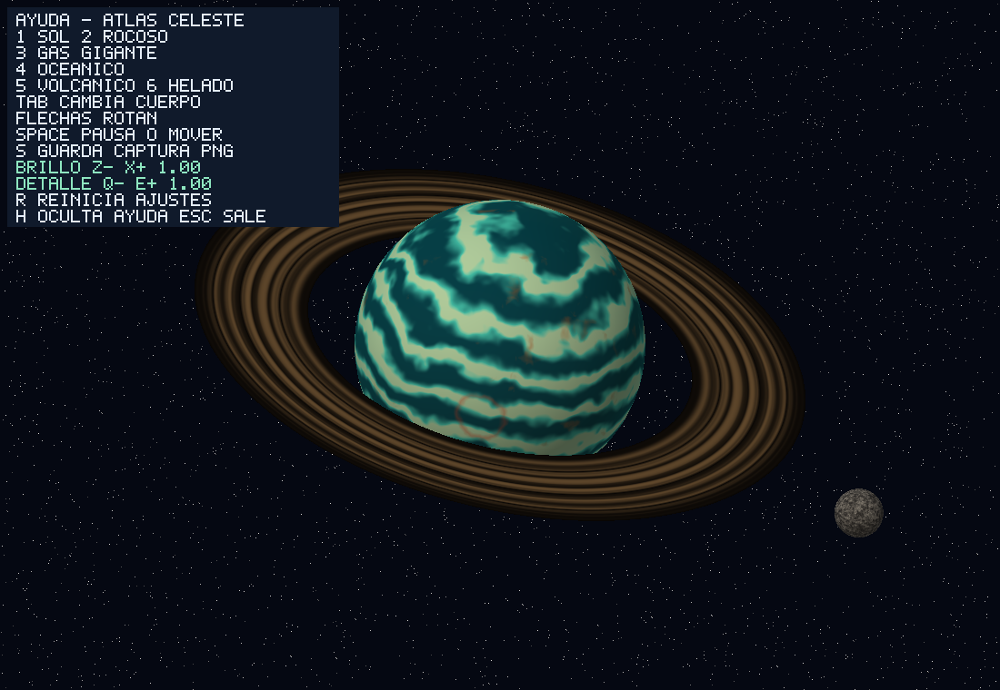

# Controles básicos

> QA headless de release aprobado. La interacción con teclado físico sigue sin comprobarse; no se afirma una prueba interactiva.

## Cómo usar en 30 segundos

1. Desde la raíz del proyecto, ejecute `cargo run --release` y pulse **3** para elegir el gigante gaseoso.
2. Pulse **Espacio** para pausar o reanudar la animación.
3. Pulse **Z** para bajar el brillo y **X** para subirlo; use **Q/E** para disminuir/aumentar la escala del patrón. **R** restablece ambos ajustes, **H** oculta o muestra la ayuda y **S** guarda una imagen limpia en `screenshots/capture.png`.

**S sobrescribe esa ruta**: si ya tiene una captura que desea conservar, haga una copia primero. Para salir pulse **Esc**.

## Teclas

| Tecla | Efecto |
|---|---|
| 1–6 / Tab | Elegir un cuerpo o pasar al siguiente. |
| Z / X | Bajar / subir brillo, paso 0.1; rango 0.25–2, inicial 1. |
| Q / E | Reducir / aumentar la escala del patrón, paso 0.1; rango 0.5–2, inicial 1. |
| R | Restaurar brillo y escala a 1; no restablece cámara ni pausa. |
| H | Mostrar u ocultar la ayuda, visible inicialmente. |
| Espacio | Pausar o reanudar animación. |
| Flechas | Rotar el cuerpo y su escena. |
| O | Activar o desactivar traslación oscilante. |
| S | Guardar `screenshots/capture.png` sin la ayuda superpuesta. |
| Esc | Salir. |

Los ajustes de brillo y patrón son globales y se conservan al cambiar de cuerpo. El detalle cambia la frecuencia espacial del patrón procedural, **no** agrega octavas de ruido ni geometría nueva. Se calcula en CPU, sin texturas ni shaders de GPU; los ajustes no garantizan un FPS específico.

## Exportar sin ventana

```sh
cargo run --release -- --help
cargo run --release -- --headless --body gaseoso --time 0 --brightness 1.2 --detail 1.4 --output mi-gaseoso.png
cargo run --release -- --headless --body gaseoso --time 0 --help-overlay --output mi-gaseoso-con-ayuda.png
```

`--brightness` y `--detail` aceptan valores finitos dentro de los rangos indicados. Por defecto ambos son 1. La exportación individual es limpia por defecto; `--help-overlay` solicita la ayuda solo con `--headless --output` individual. `--help` enumera las opciones de CLI y termina sin abrir una ventana. Para no sobrescribir capturas, use nombres de salida nuevos.

## Verificación

Según la ejecución del orquestador sobre el binario release, `python tests/verify_controls.py --self-test` pasó 4/4; portable pasó 7/7 y el modo estricto con `--fixtures C:/Users/david/AppData/Local/hermes/cache/scratch/lab5-baseline-fixtures` pasó 7/7, incluido el caso de ayuda. El modo estricto exige los siete PNG originales. Estas pruebas comprueban exportaciones y argumentos headless; no prueban teclas reales ni apariencia interactiva. Una captura automatizada anterior mediante UIA falló; no se interpreta como verificación manual ni como demostración de un fallo de la aplicación.


